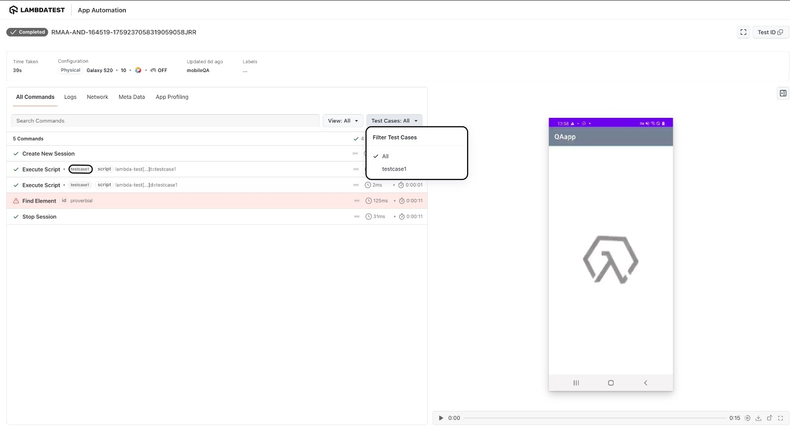
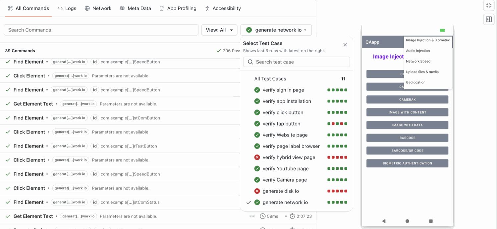
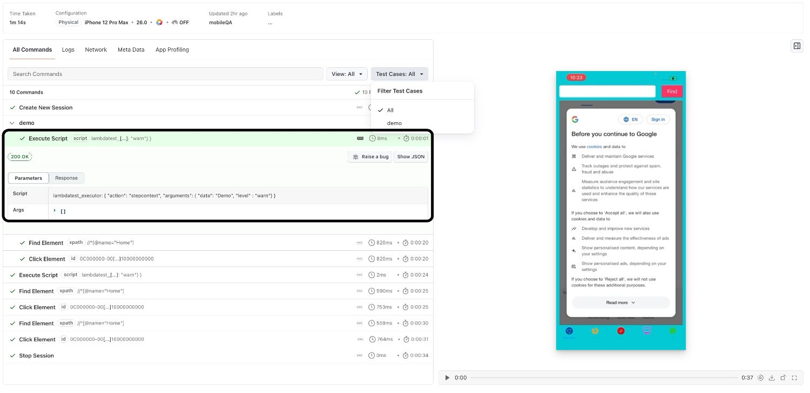

import BrandName, { BRAND_URL } from '@site/src/component/BrandName';


<script type="application/ld+json"
  dangerouslySetInnerHTML={{ __html: JSON.stringify({
    "@context": "https://schema.org",
    "@type": [
      "Article",
      "TechArticle"
    ],
    "mainEntityOfPage": {
      "@type": "WebPage",
      "@id": "https://www.testmuai.com/support/docs/appium-testmu-hooks/"
    },
    "headline": "Lambda Hooks For Appium Automation",
    "description": "Now you can add custom status & remark to your App Automation scripts that you run on TestMu AI.",
    "url": "https://www.testmuai.com/support/docs/appium-testmu-hooks/",
    "image": {
      "@type": "ImageObject",
      "url": "https://www.testmuai.com/support/assets/images/og-images/testmuai-documentation-og.webp",
      "width": 1200,
      "height": 630
    },
    "inLanguage": "en",
    "articleSection": "App Automation",
    "keywords": [
      "appium",
      "testmu ai hooks",
      "custom status"
    ],
    "proficiencyLevel": "Beginner",
    "author": {
      "@type": "Organization",
      "@id": "https://www.testmuai.com/#organization",
      "name": "TestMu AI",
      "url": "https://www.testmuai.com/"
    },
    "publisher": {
      "@type": "Organization",
      "@id": "https://www.testmuai.com/#organization",
      "name": "TestMu AI",
      "alternateName": [
        "TestMuAI",
        "TestMu",
        "LambdaTest"
      ],
      "url": "https://www.testmuai.com/",
      "logo": {
        "@type": "ImageObject",
        "url": "https://www.testmuai.com/logo.png"
      },
      "sameAs": [
        "https://www.linkedin.com/company/testmu-ai/",
        "https://x.com/testmuai",
        "https://www.youtube.com/@TestMuAI"
      ]
    },
    "hasPart": [
      {
        "@type": "SoftwareSourceCode",
        "name": "Adding custom status & remark",
        "codeSampleType": "code snippet",
        "programmingLanguage": "Java",
        "text": "((JavascriptExecutor) driver).executeScript(\"lambda-hook: {\\\"action\\\": \\\"setTestStatus\\\",\\\"arguments\\\": {\\\"status\\\":\\\"failed\\\", \\\"remark\\\":\\\"This is a sample remark for failed test \\\"}} \");"
      },
      {
        "@type": "SoftwareSourceCode",
        "name": "//Enter your Username & Accesskey here",
        "codeSampleType": "code snippet",
        "programmingLanguage": "text",
        "text": "\nOnce you have added the code snippet, the status and remark will be visible on the [<BrandName /> App Automation Dashboard](https://www.testmuai.com/login/?redirectTo=https://appautomation.lambdatest.com/build) as shown below:\n\n\n\n\n## Update Test Name\n---\n\nTo update the name of the test, just add the code snippet using the ```JavascriptExecutor```.\n\nArguments | Example\n------------- | -----------------------------------------------------------------------------------------\n```lambda-name``` | For changing the Test Name.\n\n```bash\n((JavascriptExecutor) driver).executeScript(\"lambda-name=TestName\");"
      },
      {
        "@type": "SoftwareSourceCode",
        "name": "To start a test case, use the lambda-testCase-start hook",
        "codeSampleType": "code snippet",
        "programmingLanguage": "Java",
        "text": "// To start a test case\n((JavascriptExecutor) driver).executeScript(\"lambda-testCase-start=find Name\");"
      },
      {
        "@type": "SoftwareSourceCode",
        "name": "To end a test case, use the lambda-testCase-end hook",
        "codeSampleType": "code snippet",
        "programmingLanguage": "Java",
        "text": "// To end a test case\n((JavascriptExecutor) driver).executeScript(\"lambda-testCase-end=find Name\");"
      },
      {
        "@type": "SoftwareSourceCode",
        "name": "To mark the status of a test case, use the lambda-testCase-status hook",
        "codeSampleType": "code snippet",
        "programmingLanguage": "Java",
        "text": "// To mark the open test case as passed or failed\n((JavascriptExecutor) driver).executeScript(\"lambda-testCase-status=passed\");"
      },
      {
        "@type": "SoftwareSourceCode",
        "name": "Annotation Start",
        "codeSampleType": "code snippet",
        "programmingLanguage": "Java",
        "text": "driver.execute_script(\"lambdatest_executor: {\\\"action\\\": \\\"stepcontext\\\", \\\"arguments\\\": {\\\"data\\\": \\\"youtube\\\", \\\"level\\\": \\\"debug\\\"}}\");"
      },
      {
        "@type": "SoftwareSourceCode",
        "name": "To close the executor at the end of your script, pass data as an empty string",
        "codeSampleType": "code snippet",
        "programmingLanguage": "Java",
        "text": "driver.execute_script(\"lambdatest_executor: {\\\"action\\\": \\\"stepcontext\\\", \\\"arguments\\\": {\\\"data\\\": \\\"\\\"}}\");"
      }
    ],
    "dateModified": "2026-11-11T12:00:00+05:30"
  }) }}
/>

import CodeBlock from '@theme/CodeBlock';
import {YOUR_LAMBDATEST_USERNAME, YOUR_LAMBDATEST_ACCESS_KEY} from "@site/src/component/keys";

import Tabs from '@theme/Tabs';
import TabItem from '@theme/TabItem';
import RealDeviceTag from '../src/component/realDevice';
import VirtualDeviceTag from '../src/component/virtualDevice';


<RealDeviceTag value="Real Device" /> 
<VirtualDeviceTag value="Virtual Device" />


This document will help you provide lambdahooks which can be used to improve your test scripts to easily debug your test cases for **App Automation on Real Devices** on **<BrandName /> Cloud**.

## Adding custom status & remark

To add custom status & remark, just add the code snippet using the ```JavascriptExecutor```.

```JavascriptExecutor``` accepts two arguments as shown below:

Arguments | Example
------------- | -----------------------------------------------------------------------------------------
```status``` | ```failed``` OR ```passed```
```remark``` | Any remark can be added here limited to 255 characters.

```java
((JavascriptExecutor) driver).executeScript("lambda-hook: {\"action\": \"setTestStatus\",\"arguments\": {\"status\":\"failed\", \"remark\":\"This is a sample remark for failed test \"}} ");
```

Here is a sample automation script in Java for the sample status & remark. Ensure to update the ```app_url```, ```username``` & ```accesskey``` in the below code.

```java title="android.java"
import io.appium.java_client.AppiumDriver;
import io.appium.java_client.MobileBy;
import io.appium.java_client.MobileElement;
import org.openqa.selenium.JavascriptExecutor;
import org.openqa.selenium.remote.DesiredCapabilities;
import java.net.MalformedURLException;
import java.net.URL;
public class vanilla_android {
    private static AppiumDriver driver;
    public static void main(String args[]) throws MalformedURLException, InterruptedException {

        try {
            DesiredCapabilities capabilities = new DesiredCapabilities();

            capabilities.setCapability("deviceName", "Galaxy S20");
            capabilities.setCapability("platformVersion", "11");
            capabilities.setCapability("platformName", "Android");
            capabilities.setCapability("isRealMobile", true);
            capabilities.setCapability("app", "APP_ID"); //Enter your app url
            capabilities.setCapability("build", "Java Vanilla - Android");
            capabilities.setCapability("name", "Sample Test Java");

            //Enter your Username & Accesskey here:            
            driver = new AppiumDriver(new URL("https://" +userName + ":" + accessKey + "@mobile-hub.lambdatest.com/wd/hub"), capabilities); 

            MobileElement color = (MobileElement) driver.findElement(MobileBy.id("com.lambdatest.proverbial:id/color"));
            color.click();

            //Javascript Executor for marking the status and custom remark.
            //highlight-next-line
            ((JavascriptExecutor) driver).executeScript("lambda-hook: {\"action\": \"setTestStatus\",\"arguments\": {\"status\":\"failed\", \"remark\":\"This is a sample remark for failed test \"}} ");
        }
        // The driver.quit statement is required, otherwise the test continues to execute, leading to a timeout.
        driver.quit();
    }
}
```

Once you have added the code snippet, the status and remark will be visible on the [<BrandName /> App Automation Dashboard](https://www.testmuai.com/login/?redirectTo=https://appautomation.lambdatest.com/build) as shown below:


## Update Test Name
---

To update the name of the test, just add the code snippet using the ```JavascriptExecutor```.

Arguments | Example
------------- | -----------------------------------------------------------------------------------------
```lambda-name``` | For changing the Test Name.

```bash
((JavascriptExecutor) driver).executeScript("lambda-name=TestName");
```

## Differentiating Test Cases in Single Session
---

<BrandName /> has introduced a LambdaHook to help automation engineers differentiate between multiple test cases within a single Appium session. This feature aims to improve debugging capabilities, making it easier to identify which test cases may be causing errors or taking longer to execute.

:::info
The test case hooks (`lambda-testCase-start`, `lambda-testCase-end` and `lambda-testCase-status`) are supported for App Automation on both **Real Devices** and **Virtual Devices**. They are not supported for web automation sessions.
:::

### Adding Lambda Hooks

You can use LambdaHooks to start and end a test case within a single Appium session. 

#### Test Case Start

To start a test case, use the `lambda-testCase-start` hook:

```java
// To start a test case
((JavascriptExecutor) driver).executeScript("lambda-testCase-start=find Name");
```

#### Test Case End

To end a test case, use the `lambda-testCase-end` hook:

```java
// To end a test case
((JavascriptExecutor) driver).executeScript("lambda-testCase-end=find Name");
```

### Marking the Status of a Test Case

By default, <BrandName /> derives the status of each test case from its commands: if any command executed between `lambda-testCase-start` and `lambda-testCase-end` fails, the test case is marked **Failed**. This is not always the real result. A command may fail and then pass on a retry, or a command may be expected to fail as part of a negative check (for example, verifying that an element is not displayed).

Use the `lambda-testCase-status` hook to send the real result from your framework. The status you send overrides the derived status of the test case in [Test Case Insights](/support/docs/analytics-test-case-insights/).

#### Test Case Status

Call `lambda-testCase-status` after `lambda-testCase-start` and before `lambda-testCase-end`:

```java
// To mark the open test case as passed or failed
((JavascriptExecutor) driver).executeScript("lambda-testCase-status=passed");
```

To store a remark with the status, pass the status as JSON. The `remark` is optional and is limited to `255` bytes; longer remarks are truncated.

```java
((JavascriptExecutor) driver).executeScript("lambda-testCase-status={\"status\":\"passed\",\"remark\":\"404 on first attempt, retry succeeded\"}");
```

| Argument | Description |
|----------|-------------|
| `status` | `passed` or `failed`. The value is case-insensitive. Any other value, such as `skipped`, is ignored. |
| `remark` | Optional. Any text explaining the status, limited to `255` bytes. Supported only in the JSON form. |

#### Example

The following examples mark each test case with the result your framework reports, so a retry that passed or an expected failure does not mark the test case as failed.

<Tabs className="docs__val" groupId="language">
<TabItem value="java" label="Java" default>

```java
for (TestCase tc : suite) {
    driver.executeScript("lambda-testCase-start=" + tc.getName());
    boolean passed = tc.run(); // your framework handles retries and negative checks
    driver.executeScript("lambda-testCase-status=" + (passed ? "passed" : "failed"));
    driver.executeScript("lambda-testCase-end=" + tc.getName());
}
```

</TabItem>
<TabItem value="python" label="Python">

```python
driver.execute_script(f"lambda-testCase-start={name}")
# ... test steps ...
driver.execute_script("lambda-testCase-status=passed")
driver.execute_script(f"lambda-testCase-end={name}")
```

</TabItem>
<TabItem value="cucumber" label="Cucumber (Java)">

```java
@After
public void markTestCase(Scenario scenario) {
    String status = scenario.isFailed() ? "failed" : "passed";
    ((JavascriptExecutor) driver).executeScript("lambda-testCase-status=" + status);
    ((JavascriptExecutor) driver).executeScript("lambda-testCase-end=" + scenario.getName());
}
```

</TabItem>
</Tabs>

#### How the Final Status is Decided

| Scenario | Final status of the test case |
|----------|-------------------------------|
| No `lambda-testCase-status` call | Derived from commands: **Failed** if any command failed, otherwise **Passed**. This is the same behavior as before. |
| `lambda-testCase-status` called once | The status you sent, even if it differs from the derived status. For example, `failed` marks the test case as **Failed** even when every command passed. |
| `lambda-testCase-status` called more than once | The last valid status you sent. |
| Invalid or empty value (for example, `skipped`) | The call is ignored and the test case keeps its previous status. If no valid status was sent, the derived status is used. |
| Called before any `lambda-testCase-start`, or after `lambda-testCase-end` and before the next start | The call is ignored, because no test case is open. No test case is changed. |
| Test case started but never ended | The test case is still recorded with the status you sent. |
| JSON without a `status`, or malformed JSON | The call is ignored. If no valid status was sent, the derived status is used. |

Each call returns a message to your script stating whether the status was set or why it was ignored (for example, `no active test case` or an invalid status). Ignored calls never fail the session and appear in the command logs as warnings, not errors.

:::note
`lambda-testCase-status` only sets the status of a test case. It does not change the session status, which you continue to set with `lambda-status` or `setTestStatus`. A session marked **Passed** can still contain test cases marked **Failed**, and the other way around.
:::

### Labeling and Filtering Command Logs

Any command logs executed between `lambda-testCase-start` and `lambda-testCase-end` will be labeled with the name you provide. The name should not exceed `255` characters. 

You can also filter the command logs based on these labels.A screenshot has been provided below, demonstrating the use of labels and how to filter command logs based on them.



### Viewing Test Cases and Their Trends

Every test case you mark with the start and end hooks is also listed on the automation session details page. Click the test case selector above the command logs to open the **Select Test Case** panel, which lists all the test cases recorded in the session along with the trend of their last five runs.



The panel shows the following details:

| Detail | Description |
|--------|-------------|
| **All Test Cases** | The list of every test case captured between the `lambda-testCase-start` and `lambda-testCase-end` hooks, along with the total count of test cases in the session. |
| **Search test case** | Search for a test case using the name you passed to the hook. This is helpful when a single session runs a large number of test cases. |
| **Status** | A green tick indicates that the test case passed in the current session and a red cross indicates that it failed. |
| **Last 5 runs** | The strip of squares next to each test case shows the result of its last five runs, with the latest run on the right. Green denotes a passed run and red denotes a failed run. |

Selecting a test case from the panel filters the command logs to the commands executed between that test case's start and end hooks, so you can jump straight to the section of the session you want to debug.

:::tip
The **Last 5 runs** trend lets you tell a genuinely broken test case from a flaky one without opening older sessions. A test case that is red across all five runs points to a consistent failure, whereas a mix of red and green points to flakiness that is worth investigating separately.
:::


---

## Command Annotations 

Command Annotations allow you to add metadata and debugging information to your test scripts. They work similarly to LambdaHooks by providing structured logs on the **<BrandName /> Automation Dashboard**, making it easier to track test execution, debug failures, and navigate specific test sections.



### Using Command Annotations

#### Annotation Start
```java
driver.execute_script("lambdatest_executor: {\"action\": \"stepcontext\", \"arguments\": {\"data\": \"youtube\", \"level\": \"debug\"}}");
```

**Arguments:**

| Argument | Description |
|----------|-------------|
| `data` | String value representing the information you want to log. |
| `level` | Log severity level. Acceptable values: `info` (default), `debug`, `warn`, `error`. |

#### Annotation End
To close the executor at the end of your script, pass `data` as an empty string:

```java
driver.execute_script("lambdatest_executor: {\"action\": \"stepcontext\", \"arguments\": {\"data\": \"\"}}");
```

:::info
**Mutual exclusivity:** Test case and Command Annotations cannot be used together in the same script. You can only use **one** of them per session.
:::
